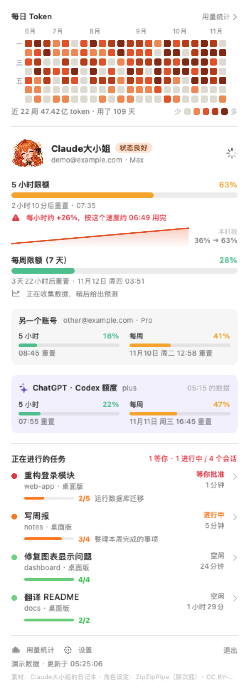
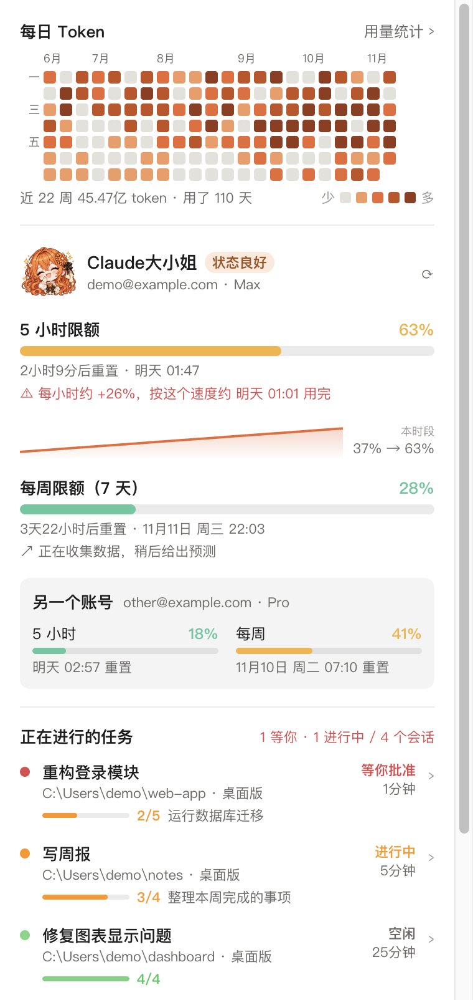
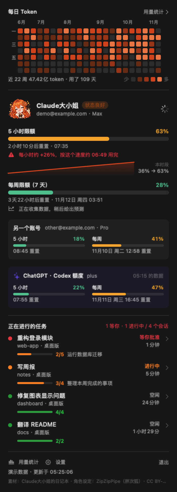
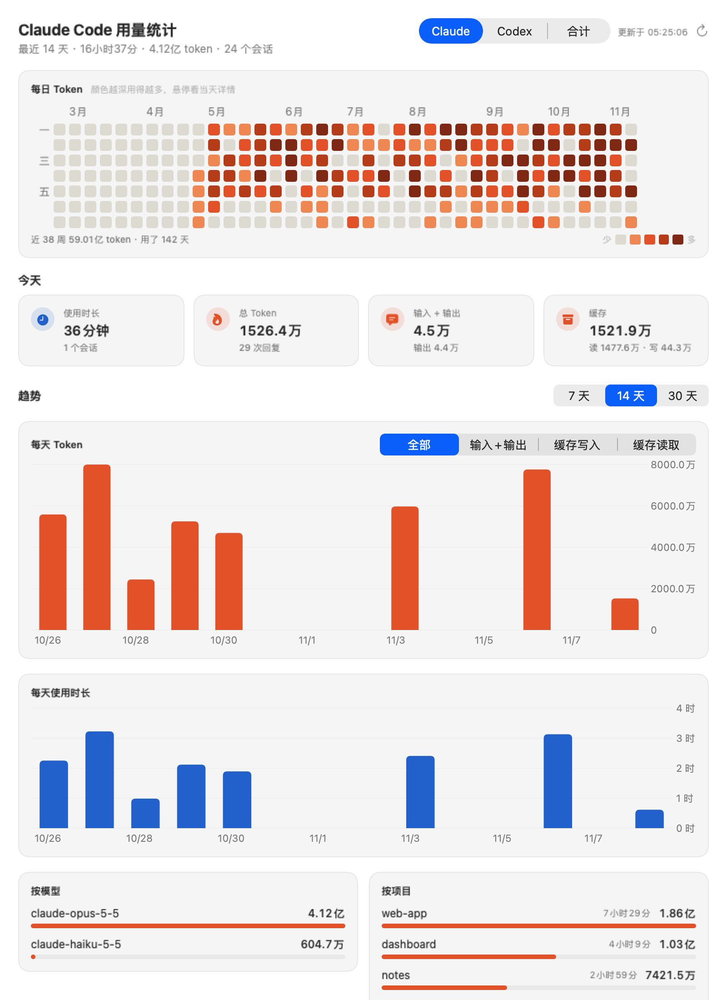
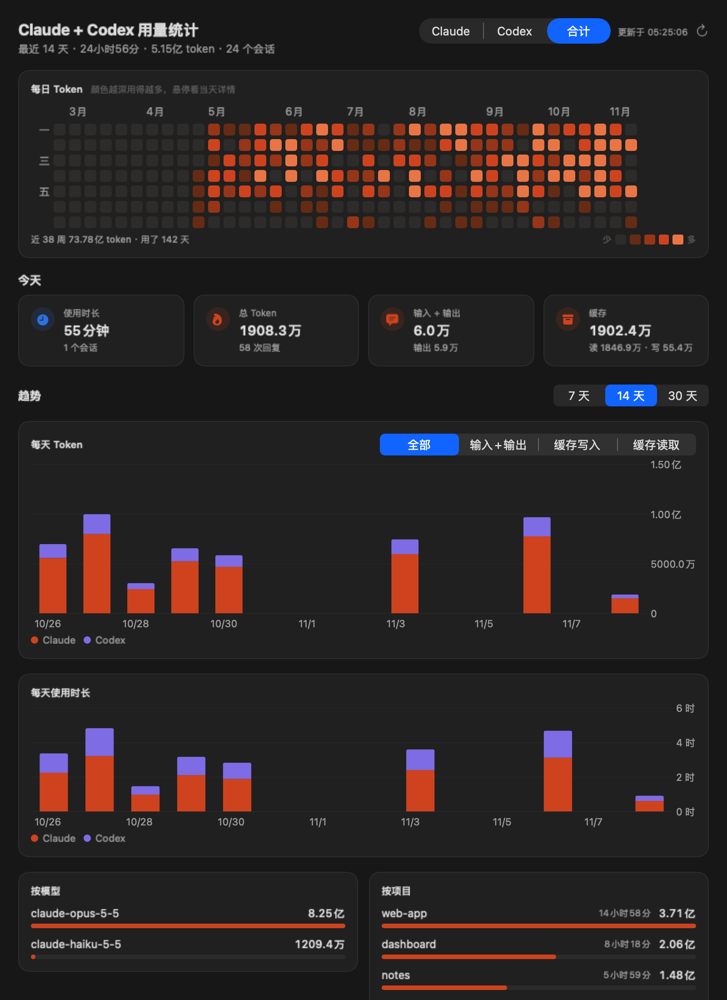
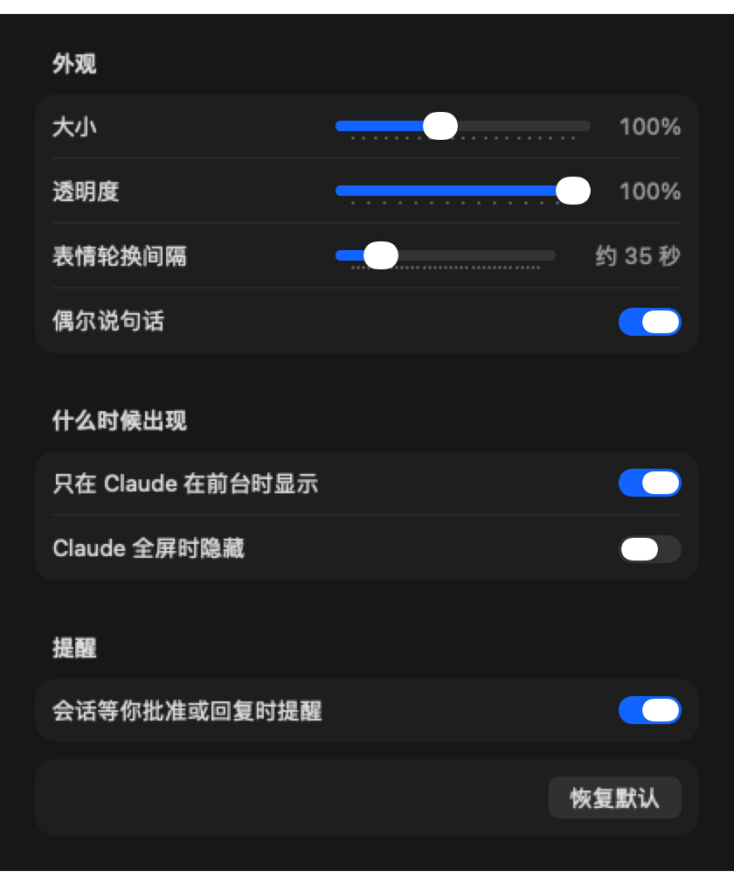

# Claude大小姐 · Claude 用量桌宠

一只住在 Claude 旁边的桌宠：随时告诉你 **Claude 账号还剩多少额度**（5 小时限额和每周限额），盯着 **正在进行的 Claude Code 任务**，在任务完成或需要你批准时叫你一声，还会统计你每天用了多少 token。

<p align="center">
  
  
  
</p>

> 截图里是演示数据。形象是 Claude大小姐（素材来自 [claude-daxiaojie-assets](https://github.com/opsCar/claude-daxiaojie-assets)，署名见文末）。
> 这是粉丝作品，和 Anthropic 官方没有关系。

---

## 下载

到 [**Releases**](../../releases/latest) 下载最新版：

| 桌宠 | 系统 | 文件 | 状态 |
|---|---|---|---|
| **Claude大小姐**（Claude） | macOS 14 及以上（Intel 和 Apple 芯片通用） | `ClaudeUsagePet-…-macOS.zip` | ✅ 可用 |
| **Claude大小姐**（Claude） | Windows 10 / 11（64 位） | `ClaudeUsagePet-Setup-…-win-x64.exe`（安装版）<br>`ClaudeUsagePet-…-win-x64-portable.zip`（免安装） | 🧪 测试版 |
| **GPT龙娘**（ChatGPT · Codex） | macOS 14 及以上 | `GPTDragonPet-…-macOS.zip` | ✅ 可用 |
| **GPT龙娘**（ChatGPT · Codex） | Windows 10 / 11（64 位） | `GPTDragonPet-Setup-…-win-x64.exe`（安装版）<br>`GPTDragonPet-…-win-x64-portable.zip`（免安装） | 🧪 测试版 |
| **Grok娘**（Grok Bot） | macOS 14 及以上 | `GrokPet-…-macOS.zip` | ✅ 可用 |
| **DeepSeek娘**（DeepSeek Harness） | macOS 14 及以上 | `DeepSeekPet-…-macOS.zip` | ✅ 可用 |

> Windows 版是用 Electron 重写的 Claude大小姐和 GPT龙娘，作者还没在 Windows 真机上完整测试过，遇到问题欢迎提 [Issue](../../issues)。Grok娘和 DeepSeek娘目前只有 Mac 版，见下方「另外三只桌宠」。

## 安装（Windows）

1. 下载 `ClaudeUsagePet-Setup-…-win-x64.exe`，双击安装（可以选择安装位置）。不想安装的话，下载 `…-portable.zip`，解压后直接运行 `ClaudeUsagePet.exe`。
2. **第一次运行**：程序没有数字签名，Windows 可能提示"Windows 已保护你的电脑"。点 **「更多信息」→「仍要运行」**。
3. 大小姐会出现在屏幕右下角，任务栏右下角的托盘里也有她的图标（右键托盘图标可以打开面板、设置或退出）。
4. 用量会依次尝试：读取 Claude 桌面版的登录 → 读取 Claude Code 的登录（`%USERPROFILE%\.claude\.credentials.json`）→ 都不行时，在面板里点 **「登录 claude.ai 查看用量」** 单独登录一次（之后会记住）。

> Windows 版也有：v3 小人、「其他额度」折叠区（Codex 实时额度、Grok Bot、DeepSeek 余额）、托盘悬停显示 5 小时额度、专注番茄钟、久坐 / 熬夜提醒、双击跳一下和摸头、说话频率和两只桌宠之间的聊天、用量统计里的 Claude / Codex / 合计切换。另外支持 **系统通知**——大小姐隐藏时（Claude 不在前台），任务完成、需要你批准或到点提醒都会弹出 Windows 通知。暂不支持：可动小人。

**GPT龙娘（Windows）**：安装 `GPTDragonPet-Setup-…-win-x64.exe` 后，她默认站在大小姐左边，只在 ChatGPT / Codex 窗口在前台时出现。额度用这台电脑上 Codex 的登录（`%USERPROFILE%\.codex\auth.json`，只读）实时查询 ChatGPT 账号的 5 小时 / 每周额度，查不到时退回本机 Codex 日志；面板里有进行中的 Codex 线程（点开会跳到 ChatGPT 里的那个线程）、Codex 用量统计，「其他额度」里能看到 Claude（由 Windows 版大小姐共享过来）、Grok Bot 和 DeepSeek。形象是 v3 小人（GPT龙娘动画素材没有开放授权，不随安装包分发）。

<p align="center"></p>

## 安装（macOS）

1. 下载并解压 zip，把 **Claude大小姐.app** 拖进「应用程序」。
2. **第一次打开**：应用没有经过苹果公证，双击会被系统拦下。
   - 先双击一次，看到提示后点「完成」；
   - 打开「系统设置 → 隐私与安全性」，在下方找到"已阻止 Claude大小姐"，点 **「仍要打开」** 并输入电脑密码。
   - 或者在终端执行：`xattr -dr com.apple.quarantine "/Applications/Claude大小姐.app"`
3. 打开后会弹出钥匙串对话框，询问能否访问 **「Claude Safe Storage」**，点「始终允许」。
   这是为了读取 Claude 桌面版的登录来查询用量：**只读、不修改、数据不离开你的电脑**。不想授权也可以点「拒绝」，之后在面板里单独登录 claude.ai。

> 建议先安装并登录 [Claude 桌面版](https://claude.ai/download)。没有桌面版也能用：在面板里点「登录 claude.ai」即可。

---

## 功能

### 桌面上的大小姐
- **只在 Claude 窗口在前台时出现**：切到浏览器、微信等其他应用时自动隐藏，切回 Claude 再出现（可在设置里关掉）。
- **头像下方是任务进度**：正在工作的 Claude Code 会话显示「⚡ 名称 · 第几步/共几步」和当前步骤；**等你批准或回复**的会话排在最前，显示「⏳ … · 等你批准」，并用红框标出。
- **最下面是限额条**：`5h 63% · 7d 28%`。
- **80 个表情**：根据用量（轻松 / 从容 / 紧张 / 崩溃）、是否有任务在跑、是否有会话在等你、是不是深夜，在对应的表情组里随机轮换；点她、任务开工、任务完成、会话等你时会有专门的反应和气泡。
- 颜色跟随系统浅色 / 深色模式；可以拖到任意位置。
- **互动**：双击她会跳一下；用鼠标在她身上来回蹭几下会害羞（脸红、「别、别摸了啦…」）。

### 菜单栏：AI 额度总览（Mac 版）
- 菜单栏显示大小姐的表情和各家额度，例如 `✳︎ 64%  ✦ 16%  ⚡ 43%  🐟 ¥16.96`：Claude 5 小时、Codex 5 小时、Grok Bot 本周、DeepSeek 余额（本机用过哪家就显示哪家）。专注时改为显示倒计时。
- 左键打开总览：每家一张额度卡片、专注番茄钟按钮；右键是大小姐的完整菜单。可在设置里关掉。

### 专注番茄钟和健康提醒（Mac 版）
- 右键「🍅 开始专注 25 分钟」（时长可在设置里调）：专注期间她安静地陪你工作，胶囊和菜单栏显示倒计时；时间到会响一声提醒你休息 5 分钟，休息结束再提醒一次。
- **久坐提醒**：连续使用 2 小时提醒起来活动、喝口水，之后每 30 分钟一次（离开键盘 5 分钟或 10 分钟没用 Claude 就重新计时）。
- **熬夜提醒**：凌晨 0–5 点还在用时，每小时提醒一次睡觉。
- 提醒会让她临时出现在任何应用上方十几秒；两个提醒都能在设置里单独关掉。
- 如果这台 Mac 上还运行着同一套代码做的其他桌宠（见下方「和其他桌宠一起用」），番茄钟和提醒会在它们之间同步，菜单栏也只保留一个图标。

### 点击后的面板



- **每日 Token 热力图**：仿 GitHub 贡献图，近 22 周、一列一周，颜色越深用得越多；悬停看当天的 token、使用时长和回复数，点击打开完整统计。
- **5 小时限额和每周限额**：百分比、重置时间，以及 **用量预测**——根据最近的增长速度估算"按这个速度几点用完"；5 小时限额下面有本时段的用量曲线。
- **其他额度**（默认折叠成一行摘要，点开看详情）：
  - **另一个账号**：可以再登录一个 claude.ai 账号，两个账号的限额同时显示；
  - **ChatGPT · Codex**（Mac 版）：从本机 Codex 会话记录里读出的 5 小时 / 每周额度；
  - **Grok Bot**（Mac 版）：Grok Bot 桌面版缓存在本机的每周额度；
  - **DeepSeek**（Mac 版）：DeepSeek Harness 记在本机的账户余额、今天和近 7 天的花费。
- **所有 Claude Code 会话**：进行中 / 等你确认 / 空闲、所在项目、持续时间、步骤进度条。**点击会话直接在 Claude 里打开它。**

<br clear="right">

### 用量统计（Dashboard）



- 近 38 周的每日 Token 热力图。
- **今天**：使用时长、会话数、总 token、回复数、输入/输出、缓存读写。
- **最近 7 / 14 / 30 天**：每天的 token（可切换 全部 / 输入+输出 / 缓存写入 / 缓存读取）和使用时长，悬停看数值。
- 按模型、按项目的用量排行。
- **Claude / Codex / 合计** 切换（Mac 版大小姐；Windows 版大小姐和 GPT龙娘都有）：合计模式下柱状图按来源叠加显示（Claude 橙色、Codex 紫色）。



### 设置



大小、透明度、表情轮换间隔、形象、是否偶尔说话、只在 Claude 前台时显示、Claude 全屏时隐藏、会话等你时提醒；以及菜单栏总览、久坐提醒、熬夜提醒、专注时长、说话频率、桌宠之间聊天（这几项和其他桌宠共用）。

### 说话和聊天

- 每只桌宠有自己的性格和台词（大小姐傲娇、龙娘温柔、Grok娘吐槽、DeepSeek娘精打细算），一共五百多句：按当前状态（额度充足 / 紧张 / 见底、有任务在跑、会话等你、深夜）、时间段（早上、午饭、下午茶、晚上、快半夜）、星期（周一、周五、周末）挑，偶尔插一句冷知识或玩笑，会带上实时的额度数字；说过的话要隔十几句才会再说。
- **说话频率**：安静（约 90 秒一句）/ 适中（约 30 秒，默认）/ 话痨（约 15 秒）。
- **桌宠之间聊天**：开着两只以上桌宠时，每隔 7–15 分钟（你在用电脑、没在专注时）会挑两只聊几句，另一只会出来一会儿再回去；会看彼此的额度说话，比如一只额度快用完时另一只说「交给我吧」。不想被打扰可以在设置里关掉。
- **和她互动**（四只桌宠都有，Mac 和 Windows 都支持）：
  - 拖起来她会喊一声，放下会评价新位置；拖着来回晃会晕；连续双击三次会生气「别戳了！」；鼠标在她身上停两秒她会问你怎么了；摸头会害羞。
  - 右键「投喂」：每只有自己的零食，喂到最爱的会特别开心（大小姐爱红茶、龙娘爱热可可、Grok娘爱冰美式、DeepSeek娘爱小鱼干），一小时喂太多会说吃不下。
  - 右键「陪我聊聊」：马上说句话，或者讲个冷知识 / 笑话。
  - 你批准了等待中的会话，它继续干活时她会说「收到！继续～」；离开电脑 10 分钟以上回来时会说「欢迎回来」。
  - 把一只桌宠拖到另一只身上（两只都在屏幕上时），她们会互相打招呼、斗两句嘴。
- 台词都在 `Assets/banter.json` 里，Mac 版和 Windows 版共用，想加自己的台词直接改这个文件再重新构建即可。

### v3 小人（Mac 版）

大小姐的第三种形象：Claude娘设定图里的 **8 种表情立绘**（自然微笑、平静、惊讶、害羞、鼓腮、闭眼轻笑、认真、委屈），按状态换表情——有任务在跑是认真脸，会话等你是惊讶脸，额度紧张鼓腮、快用完委屈，摸头害羞，任务完成闭眼笑。平时不晃动，只在反应时短暂跳一下或抖一下。


素材来自 [lmy414/ai-chan-sheets](https://github.com/lmy414/ai-chan-sheets)（Claude娘设定图，角色设定 ZipZipPipe，CC BY-NC-SA 4.0），本项目用 `Tools/make_v3_assets.py` 去掉白底、缩小尺寸后放在 `Assets/v3/`，随安装包一起发布。在面板的切换条（表情头像 / 可动小人 / v3 小人）、点头像、右键菜单或设置里切换。

### 可动小人模式（可选，仅 Mac 版）

除了 80 个表情头像，大小姐还可以切换成**会动的全身小人**：待机、看书工作（有任务在跑）、等待（会话等你）、检查 / 受挫（额度紧张 / 告急）、跳跃（任务完成）、挥手（点她）、拖动时左右跑，空闲时目光跟着鼠标转（16 个方向）。

切换方式：点开面板，名字下方的「😊 表情头像 | 🧍 可动小人」切换条；或者点面板里的头像、右键菜单「切换成可动小人」、设置里的「可动小人模式」。

> 小人素材来自 [houn1u/claude-lady-pets-v2](https://github.com/houn1u/claude-lady-pets-v2)，该仓库**没有开放授权**，所以本项目和 Releases 安装包里都**不包含**这张图，也不会显示切换按钮。想在自己电脑上用的话：
>
> ```bash
> mkdir -p Assets/claude-lady
> curl -L -o Assets/claude-lady/spritesheet-extended.png \
>   https://raw.githubusercontent.com/houn1u/claude-lady-pets-v2/main/assets/spritesheet-extended.png
> ./build.sh        # 检测到素材就会打包进本机的 app，切换按钮随之出现
> ```
>
> `Assets/claude-lady/` 已在 `.gitignore` 里；`package.sh` 生成分享安装包时会自动排除这张图（`EXCLUDE_LADY=1`）。

---

## 使用方法

| 操作 | 效果 |
|---|---|
| **单击**大小姐 | 打开面板（用量、预测、任务列表、热力图） |
| **双击** | 跳一下 |
| 鼠标在她身上**来回蹭** | 害羞反应 |
| **拖动** | 移动位置（会记住） |
| **右键** | 菜单：开始专注、用量统计、立即刷新、重新读取桌面版登录、登录 / 切换 claude.ai 账号、添加或移除另一个账号、设置、开机自动启动、回到右下角、素材署名、退出 |
| 面板里**点会话** | 在 Claude 桌面版里打开那个会话；终端里的会话会打开它的项目文件夹 |
| 面板里**点热力图**或「用量统计」 | 打开 Dashboard |
| 面板里**点切换条或头像** | 在表情头像、可动小人（需要本机有小人素材）和 v3 小人之间切换 |
| 面板里**点「其他额度」** | 展开 / 收起另一个账号和其他工具的额度 |
| 菜单栏图标 | 左键：AI 额度总览；右键：大小姐的菜单 |

**表情和情绪是怎么来的**

| 情况 | 表情组 |
|---|---|
| 5 小时 / 每周用量较高的那个 < 40% | 轻松愉快（星星眼、大笑、吃西瓜…） |
| < 70% | 从容喝茶 |
| < 90% | 紧张冒汗 |
| ≥ 90% | 崩溃（灵魂出窍、融化…） |
| 还没拿到用量 | 疑惑好奇 |
| 有会话在工作 / 在等你 / 凌晨 1–6 点 | 额外混入"认真工作" / "叫你" / "犯困"组 |

---

## 数据从哪里来（隐私说明）

所有数据都在你自己的电脑上读取和保存，应用不会把任何数据发给除 claude.ai / Anthropic 以外的地方。

| 内容 | 来源 |
|---|---|
| 账号用量（5 小时 / 每周） | 依次尝试：① Claude 桌面版的 claude.ai 登录（读取它的 cookie，只读；Mac 需要一次钥匙串授权，Windows 用系统的 DPAPI 解密）；② Claude Code 的登录令牌（Mac 在钥匙串，Windows 在 `%USERPROFILE%\.claude\.credentials.json`；只读，过期就跳过）；③ 在应用里单独登录的 claude.ai。查询的是 claude.ai 自己的用量接口。 |
| 正在进行的任务 | `~/.claude/sessions/*.json`（每个 Claude Code 会话都会写，含状态 busy / waiting / idle） |
| 任务步骤进度 | 会话记录里的任务清单（update_plan / TodoWrite） |
| 每日 token 和使用时长 | `~/.claude/projects/**/*.jsonl` 会话记录：token 取每条回复的 `usage`（按消息 id 去重；同一条回复分几行写入时取最大值）；活跃时长按同一会话中相邻记录间隔 ≤ 5 分钟累计，几个会话同时进行时各自计时再相加 |
| Codex 额度和用量（Mac 版） | `~/.codex/sessions/**/rollout-*.jsonl`（ChatGPT 桌面版和 Codex CLI 写的本地记录）：额度取最新的 `rate_limits`，token 取累计 `token_count` 的增量 |
| Grok Bot 额度（Mac 版） | Grok Bot 桌面版的本地缓存 `~/Library/Application Support/Grok Bot/sand-client-persistence/` 里的 `weekly-usage.cache`（每周已用百分比、重置时间、套餐名；Grok Bot 打开时才会更新） |
| DeepSeek 余额（Mac 版） | DeepSeek Harness 的 `~/.dsh/.dshw-usage.json`（余额、每天花费；不读 API 密钥，不联网） |
| 和其他桌宠共享 | Mac 版把最新的 Claude 额度（只有百分比、重置时间和套餐名）写进 `~/Library/Application Support/AIPets/claude.json`；番茄钟状态在同目录的 `hub.json`；共用设置在 `local.aipets.shared` |
| 本地缓存 | Mac：`~/Library/Application Support/ClaudeDaxiaojie/`；Windows：`%APPDATA%\ClaudeUsagePet\`（用量历史、统计缓存、设置） |

只统计这台电脑上的 Claude Code（桌面版和终端都算）和 Codex，不包括其他设备、网页版聊天。

### 另外三只桌宠（macOS）

同一套代码还做了三只桌宠，源码在 `companions/`，安装包在 Releases：

| 桌宠 | 出现在 | 额度 / 数据 | 形象 |
|---|---|---|---|
| **GPT龙娘** | ChatGPT 桌面版（Codex） | 用本机 Codex 的登录（`~/.codex/auth.json`，只读）向 ChatGPT 账号查实时的 5 小时 / 每周额度；Codex 线程、每日 token 统计 | GPT娘（白龙娘）的 8 种表情；可选 GPT龙娘动画（`companions/ChatGPTPet/fetch-dragon.sh` 下载到本机，素材无开放授权，不随安装包分发） |
| **Grok娘** | Grok Bot 桌面版 | Grok Bot 缓存在本机的每周额度；最近活跃的机器人 | Grok娘的 8 种表情 |
| **DeepSeek娘** | DeepSeek Harness | 账户余额、今天 / 近 7 天花费、还能用几天；会话列表；用量统计窗口（每日花费、token、余额变化、按模型） | DeepSeek娘 Q版冬装 2 的 8 种表情 |

共用的部分：`companions/Companion/`（三只共用的主程序）、`Sources/PetHub.swift`（菜单栏、番茄钟、提醒的协调）、`Sources/Peers.swift`（各家额度）、`Sources/V3Figure.swift`、`Sources/PetChrome.swift`。几只同时运行时，按「Claude大小姐 → GPT龙娘 → Grok娘 → DeepSeek娘」的顺序由第一只在运行的桌宠显示菜单栏图标并负责计时；提醒由当前前台应用对应的那只桌宠弹出。每只都可以单独使用。

```bash
companions/ChatGPTPet/build.sh      # 或 GrokPet / DeepSeekPet
companions/package.sh               # 三只的安装包 → dist/
```

---

## 从源码构建

需要 macOS 14+ 和 Xcode 命令行工具（`xcode-select --install`），不需要打开 Xcode。

```bash
git clone https://github.com/jayden-dong411/claude-usage-pet.git
cd claude-usage-pet
./build.sh                      # 生成 build/Claude大小姐.app
open build/Claude大小姐.app
./package.sh                    # 生成 dist/Claude大小姐.zip（通用版 app + 安装说明 + 素材署名）
```

`build.sh` 会编译 Intel + Apple 芯片的通用版本，检查 80 个表情都被用上，并去掉贴图的白色外框。

检查界面：`build/Claude大小姐.app/Contents/MacOS/DoroPet --snapshot <目录> [--demo] [--wait 秒]` 会离屏输出各界面的截图后退出（`--demo` 使用演示数据）。

### Windows 版（Electron）

源码在 `windows/`，功能和 Mac 版一一对应。Windows 安装包可以直接在 Mac 上交叉打包：

```bash
cd windows
npm install                     # 安装 Electron、electron-builder、sql.js
./prepare-assets.sh             # 生成去白边的 80 张表情和图标（用到 Mac 上的 Swift 工具）
npm start                       # 在本机直接运行（Mac 上也能跑，用来调试界面）
npm run snapshot                # 用演示数据离屏输出各界面截图
npm run dist:win                # 生成 ../dist/windows/ 下的安装版 exe 和免安装 zip
npm run start:gpt               # 运行 GPT龙娘（main-gpt.js）
npm run dist:win:gpt            # 打包 GPT龙娘（配置在 build-gpt.json）
```

| 文件 | 作用 |
|---|---|
| `main.js` | 窗口、托盘、菜单、数据刷新、表情轮换、只在 Claude 前台时显示 |
| `main-gpt.js` / `lib/codex.js` | GPT龙娘：Codex 实时额度、线程状态和步骤进度、Codex 每日统计（和界面共用 `renderer/`） |
| `lib/usage.js` | 用量接口；Windows 上用 DPAPI + AES-GCM 读取 Claude 桌面版的登录 |
| `lib/foreground.js` | 用常驻 PowerShell 检测前台程序和是否全屏 |
| `lib/sessions.js` / `lib/indexer.js` / `lib/history.js` | 会话与步骤进度、每日统计、用量预测（和 Mac 版同一套规则） |
| `lib/expressions.js` | 表情分组（由 `gen-expressions.py` 从 `Sources/Expressions.swift` 生成） |
| `lib/play.js` | 互动：拖动、摇晃、连戳、悬停、投喂、陪聊、欢迎回来、两只桌宠相撞 |
| `lib/banter.js` / `lib/duet.js` | 台词（读 `Assets/banter.json`）；两只 Windows 桌宠之间的聊天（通过 `%APPDATA%\AIPets` 里的文件） |
| `lib/peers.js` | 「其他额度」：Codex 实时额度、Grok Bot、DeepSeek 余额；两只桌宠通过 `%APPDATA%\AIPets\*.json` 互相共享额度 |
| `renderer/` | 桌宠、面板、用量统计、设置四个界面 |

### 目录结构

```
Sources/
  App.swift            桌宠窗口、菜单、表情轮换、窗口管理
  Model.swift          用量和会话的数据模型
  Data.swift           用量接口、会话读取
  DesktopLogin.swift   读取 Claude 桌面版的登录 cookie
  Progress.swift       从会话记录还原任务步骤进度
  History.swift        用量历史和预测
  UsageIndex.swift     每日 token / 时长统计（增量索引）
  Expressions.swift    80 个表情的分组
  LadySprite.swift     可动小人模式：图集切帧、动画播放、目光跟随鼠标
  PanelView.swift      点击后的面板
  Heatmap.swift        每日 Token 热力图、图表配色
  DashboardView.swift  用量统计窗口
  Settings.swift       设置和深浅色配色
  CodexSide.swift      Codex 的每日用量统计
  V3Figure.swift       v3 小人：按状态切换 8 种表情
  Peers.swift          Codex / Grok Bot / DeepSeek 的额度读取和「其他额度」卡片
  PetHub.swift         菜单栏总览、番茄钟和提醒（多只桌宠之间同步）
  PetChrome.swift      桌宠窗口里的视图（点击、双击、摸头、拖动），面板超出屏幕时滚动
  Banter.swift         读取台词库，按状态 / 时间挑一句；桌宠之间的对话
  PetPlay.swift        互动：拖动、摇晃、连戳、悬停、投喂、陪聊、欢迎回来、桌宠相撞
Tools/strip_outline.swift   构建时去掉贴图白边
Tools/make_v3_assets.py     从 ai-chan-sheets 设定图切出 v3 表情并去掉白底
Assets/daxiaojie/head/      80 张表情（CC BY-NC-SA 4.0）
Assets/v3/                  v3 小人的 8 张表情（CC BY-NC-SA 4.0）
Assets/banter.json          四只桌宠的台词和对话（Mac 和 Windows 共用）
```

---

## 常见问题

**大小姐不见了？** 默认只在 Claude 在前台时显示。切到 Claude 看看；或在设置里关掉「只在 Claude 在前台时显示」。

**用量一直显示"—"？** 确认 Claude 桌面版已登录，并在钥匙串弹窗里点了「始终允许」；也可以右键「重新读取桌面版登录」，或「登录 / 切换 claude.ai 账号」单独登录。

**更新应用后又弹钥匙串授权？** 应用没有正式签名，每个新版本系统都会再确认一次，点「始终允许」即可。

**点会话只打开了 Claude，没跳到那个会话？** 这个功能依赖 Claude 桌面版的 `claude://` 链接，请把 Claude 更新到最新版本。

**Windows 上用量读不到桌面版登录？** Claude 桌面版运行时可能会锁住它的 cookie 文件，这时会自动退回到下一种方式。在面板里点「登录 claude.ai 查看用量」登录一次即可，之后会记住。

**Windows 上大小姐不出现？** 默认只在 Claude 窗口在前台时显示。可以从任务栏托盘图标打开面板，或在设置里关掉「只在 Claude 在前台时显示」。

---

## 计划

- [x] Windows 版本（测试版）
- [ ] Windows 版在真机上的完整测试
- [ ] 正式签名和公证，免去首次打开的手动步骤

## 署名与许可

- **代码**：[MIT License](LICENSE)。
- **另外三只桌宠的形象**（`companions/*/Assets/v3/`）：ai-chan-sheets 里 GPT娘（白龙娘）、Grok娘、DeepSeek娘 Q版冬装 2 的设定图表情，补全部分 CC BY-NC-SA 4.0；原始角色设定 ZipZipPipe（DeepSeek娘 Q版冬装的来源图作者未标注）。
- **v3 小人**（`Assets/v3/`）：Claude娘设定图的 8 种表情 · 设定图：[lmy414/ai-chan-sheets](https://github.com/lmy414/ai-chan-sheets) · 角色设定：ZipZipPipe · [CC BY-NC-SA 4.0](https://creativecommons.org/licenses/by-nc-sa/4.0/deed.zh-hans)。本项目去掉了白底、缩小了尺寸，按同一协议发布，**不能用于商业用途**。
- **形象图片**（`Assets/daxiaojie/`）：素材：Claude大小姐的日记本（[github.com/opsCar/claude-daxiaojie-assets](https://github.com/opsCar/claude-daxiaojie-assets)）· 角色设定：ZipZipPipe（胖次狐）· 设定图：lmy414/ai-chan-sheets · [CC BY-NC-SA 4.0](https://creativecommons.org/licenses/by-nc-sa/4.0/deed.zh-hans)。本项目只缩小了尺寸并在构建时去掉白色外框，按同一协议发布，**不能用于商业用途**。
- 「Claude」是 Anthropic 的商标；本项目是非官方的粉丝作品。
